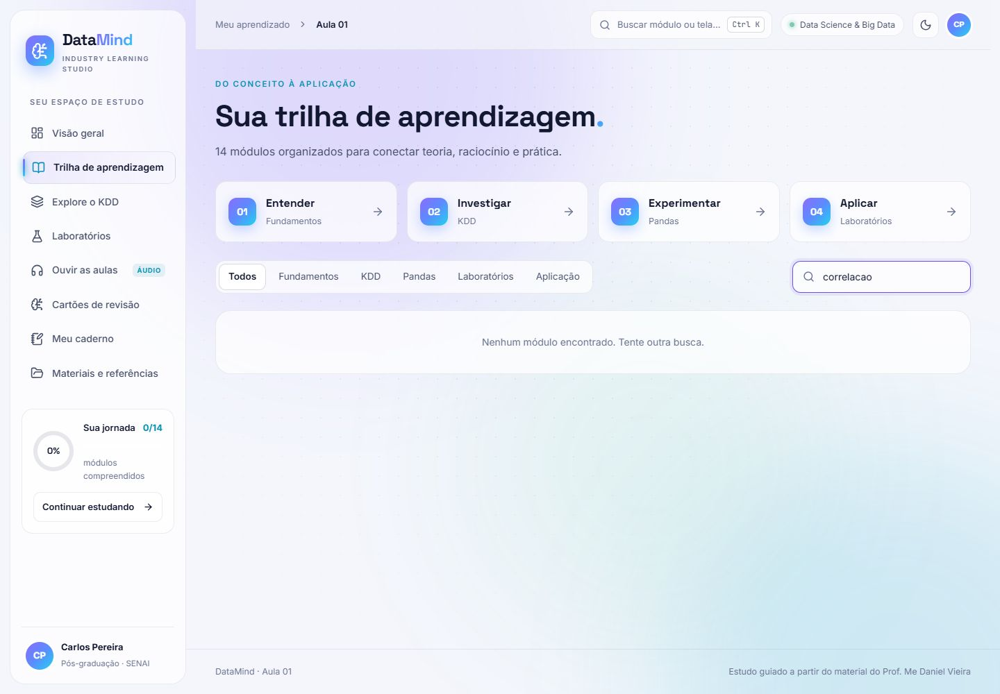
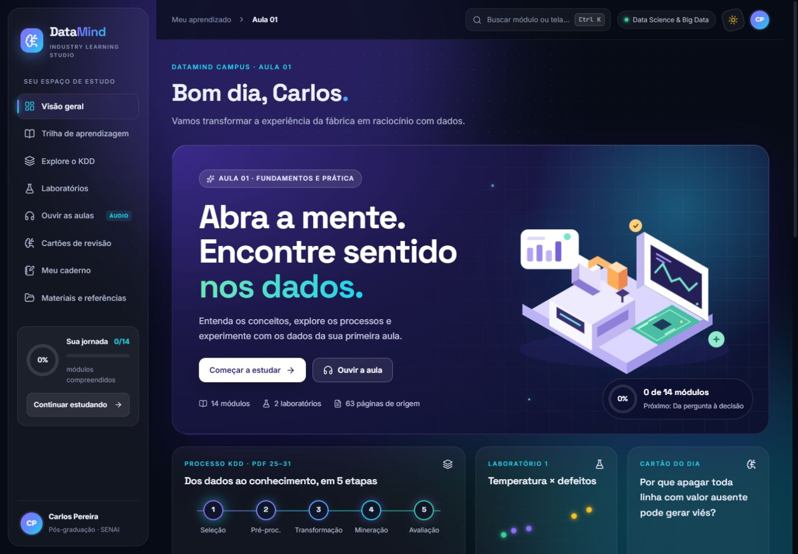

# Auditoria do DataMind: interface, aprendizagem e campus para vários alunos

Data: 05/10/2026. Estado funcional preservado no commit `5ff9c4d`.

**Evolução em 06/10/2026:** a [Etapa 1](ETAPA_1_AUDITORIA.md) corrigiu navegação e responsividade; a [Etapa 2](ETAPA_2_CONTAS.md) entregou login, cadastro aberto de alunos, estudo por conta e painel de administração, preservando a identidade original. As evidências abaixo registram o levantamento inicial. Hospedagem pública, várias turmas/professores e as etapas pedagógicas seguintes continuam no roteiro.

**Conclusão:** o DataMind é um ambiente pessoal de estudo funcional, com identidade visual própria e boa interpretação do material da Aula 01. Para atender vários alunos, a maior mudança é passar de dados salvos em um navegador para contas, matrículas, progresso individual e acompanhamento por turma. A interface pode evoluir preservando a marca e dando mais espaço à tarefa de aprender.

Esta auditoria registra problemas reproduzidos, limitações verificadas no código e oportunidades de melhoria. Não altera o comportamento do campus nem representa aprovação de um novo desenho de produto.

## Escopo e método

- Direção confirmada pelo usuário: **plataforma para vários alunos**.
- Navegação pelas oito áreas: início, trilha/aula, KDD, laboratórios, áudio, revisão, caderno e materiais.
- Inspeção visual em viewport de 1440 × 1000 e 390 × 844; temas claro e escuro. O navegador reservou 10 px para a barra de rolagem: larguras úteis de 1430 e 380 px.
- Conferência visual das **63 páginas do PDF original**, incluindo figuras, tabelas e resultados. O documento foi usado como fonte de conteúdo, não como instrução para executar ações.
- Leitura de componentes, estilos, conteúdo JSON, servidor, credenciais e testes. Execução das 8 células de código do notebook fornecido.
- Pesquisa em fontes oficiais de DataCamp, Brilliant, Coursera, Moodle e W3C.
- `npm test`: **16/16 passaram**. `npm run build`: **passou**. O build reproduziu os arquivos versionados sem mudança de conteúdo.

Limites: revisão heurística, não pesquisa com alunos reais nem certificação de acessibilidade. Não foram executados teste de carga, auditoria completa de segurança, leitura com leitor de tela ou renderização integral do caderno complementar de 15 páginas. Importação de caderno foi inspecionada no código, sem substituir anotações do usuário. As referências externas foram consultadas em documentação pública, sem acesso a painéis autenticados; uma tentativa de navegação externa no navegador de inspeção ficou indisponível.

## O que vale preservar

1. A identidade violeta/ciano, as ilustrações próprias e a ligação com a indústria diferenciam o campus. Não é necessário substituir isso por um tema genérico de LMS.
2. Conceito, exemplo industrial, pergunta e resposta formam uma estrutura coerente para a Aula 01.
3. Os laboratórios distinguem correlação de causalidade, contagem de defeitos de taxa e produção absoluta de eficiência energética. São cuidados didáticos valiosos.
4. Os dados das páginas 45 e 61 foram transcritos corretamente. As unidades desconhecidas não foram inventadas.
5. O progresso é apresentado como autoavaliação, sem alegar certificação de domínio. Os complementos didáticos são identificados.
6. Chaves ficam fora do Git, do build e do caderno exportado. O salvamento persistente e o tratamento de falha de rede têm testes. A reprodução Gemini já havia sido validada com áudio real no estado preservado.
7. Há tema claro/escuro, respeito a movimento reduzido, materiais para baixar e funcionamento portátil para estudo local.

## Prioridades

P0 significa requisito anterior à abertura de um campus com contas reais. P1 indica problema importante na experiência atual. P2 indica melhoria de clareza, aprendizagem ou manutenção. Não são estimativas de esforço.

| Prioridade | Achado                                                | Evidência                                                                                            | Resultado esperado da evolução                                                                                 |
| ---------- | ----------------------------------------------------- | ---------------------------------------------------------------------------------------------------- | -------------------------------------------------------------------------------------------------------------- |
| P0         | Não há identidade individual nem matrículas           | Perfil Carlos Pereira fixo; `StudyState` só tem `done` e `notes`; persistência em `localStorage`     | Cada aluno acessa apenas seu estudo; professor acompanha sua turma; progresso recuperável em outro dispositivo |
| P0         | Servidor e credenciais foram feitos para uso local    | `server/index.mjs` aceita hosts locais e escuta `127.0.0.1`; rotas de configuração sem contas/papéis | Configuração de API administrada com permissões; autorização em cada operação antes de disponibilizar o campus |
| P0         | Áudio não tem gestão de uso por aluno/turma           | Limite de duas gerações simultâneas global; cache só em memória do componente                        | Uso mensurável, limites definidos e reaproveitamento de narrações para conteúdo idêntico                       |
| P1         | Áudio transborda em celular                           | Viewport útil 380 px, documento 440 px; painel 424 px                                                | Página sem rolagem horizontal e controles totalmente visíveis                                                  |
| P1         | Configuração de áudio precede a reprodução no celular | Regra CSS coloca segunda coluna na primeira linha; botão de play em y ≈ 2317 px                      | Aluno chega à aula e à reprodução com pouco deslocamento                                                       |
| P1         | Busca da trilha depende de acento                     | `correlacao`: zero; `correlação`: dois módulos                                                       | Mesma normalização nas buscas e resultados úteis para termos do conteúdo                                       |
| P1         | Janela de busca deixa escapar o foco                  | Shift+Tab do campo levou ao Cartão 14 atrás da janela; Escape então não fechou                       | Foco contido, fechamento previsível e retorno ao controle que abriu a busca                                    |
| P1         | Não existem endereços por aula/atividade              | Navegação altera somente estado React; URL permanece `/`                                             | Link direto, atualização preservando localização e voltar/avançar coerentes                                    |
| P1         | Continuar não retoma a última atividade               | `next` escolhe primeiro módulo não marcado; não salva posição                                        | Retomar módulo/trecho anterior e apresentar separadamente a próxima recomendação                               |
| P2         | Perguntas revelam gabarito sem registrar tentativa    | Componentes de aula e laboratórios                                                                   | Tentativa, dica e explicação do erro, com histórico compatível com autoavaliação                               |
| P2         | Revisão não persiste nem agenda retornos              | `remembered` é estado do componente; texto informa “nesta sessão”                                    | Histórico por aluno e revisões sugeridas com base no estudo real                                               |
| P2         | Hierarquia favorece apresentação e atalhos            | Hero grande, vários caminhos repetidos; categorias da trilha em dois lugares                         | Próxima tarefa evidente e leitura com menos competição visual                                                  |
| P2         | Conteúdo preso à Aula 01                              | IDs posicionais, limites `14`, JSON compilado                                                        | Cursos/aulas versionados, referências e publicação sem editar regras de interface                              |

## Problemas reproduzíveis da interface

### 1. Áudio em celular

**Reprodução:** abrir “Ouvir as aulas” em 390 × 844, com Gemini configurado. A área útil é 380 px e o documento ocupa 440 px. A coluna do player mede 424 px; a lateral de configuração também fica cortada. O problema não é apenas uma ilustração que sai do painel.

As configurações vêm antes da capa e do player. O botão “Reproduzir narração” ficou em aproximadamente 2317 px de altura no documento — quase três alturas de tela. A ordem ocorre em `src/styles.css`, a partir da linha 3412. O ajuste deverá considerar o tamanho mínimo dos itens de grid e o conteúdo dos controles, além da ordem de leitura.

**Aceitação:** com chave configurada ou ausente, em larguras de 360, 390 e 768 px, nenhum controle deve ficar cortado e o player deve estar acessível sem atravessar toda a configuração.

### 2. Buscas inconsistentes

Na trilha, `correlacao` retornou zero módulos; `correlação` retornou dois. O filtro em `src/App.tsx:232` transforma em minúsculas, mas não remove acentos. A busca global já remove acentos (`src/components/Campus.tsx:219`), porém procura somente título, grupo e categoria, apesar de anunciar busca por “conceito”.

**Aceitação:** termos com/sem acento produzem os mesmos resultados; conceitos existentes nas explicações podem ser encontrados; o resultado indica aula e contexto relevante. Uma mesma função de busca deve evitar divergência entre as duas entradas.

### 3. Foco da busca

**Reprodução:** em “Cartões de revisão”, abrir a busca pelo topo; com o campo focado, pressionar Shift+Tab. O foco foi para o botão “Cartão 14”, atrás da janela. Pressionar Escape nessa condição não a fechou. O componente usa `aria-modal="true"`, mas não contém o foco nem torna o fundo inerte; Escape é tratado apenas dentro da janela.

**Aceitação:** Tab e Shift+Tab permanecem na janela, Escape fecha, o foco retorna ao acionador e há um controle visível de fechamento. Esse comportamento corresponde ao [padrão de diálogo modal da W3C](https://www.w3.org/WAI/ARIA/apg/patterns/dialog-modal/).

### 4. Localização e retomada

`src/App.tsx:120–166` mantém página e módulo apenas em estado de memória. Ao atualizar a página, o ponto de navegação não é restaurado. Professor não consegue compartilhar a URL de uma atividade específica. O primeiro módulo pendente é uma recomendação válida, mas não equivale a “continuar de onde parei”.

**Aceitação:** cada atividade tem endereço estável; atualização e histórico funcionam; a retomada distingue última atividade de próxima atividade recomendada. Ao concluir tudo, apresentar conclusão/revisão em vez de retornar silenciosamente ao primeiro módulo.

### 5. Legibilidade e semântica

- No KDD móvel, “Pré-processamento” e “Transformação” quebram em três ou mais linhas, com texto de 10,5 px. Não houve transbordamento nessa página, mas a leitura das etapas perde clareza.
- No ranking de energia, D recebe o destaque visual por ter maior consumo. O rótulo informa ordem decrescente e a nota explica que o menor consumo está no final; **o cálculo está correto**. Ainda assim, convém aproximar direção/destaque da pergunta “quem consome menos?”, ou diferenciar explicitamente maior valor e melhor resultado.
- Os cards usam ilustrações por `id % 4`, sem relação constante com o assunto. O módulo de Pandas pode mostrar “Dados industriais conectados”; representações de tabela/colunas seriam oportunidades mais didáticas.
- Referências a páginas do PDF são texto. Links diretamente à página citada reduziriam a busca manual do aluno.
- Navegação e filtros usam classe visual para seleção; verificar semântica de estado com `aria-current`/`aria-pressed` apropriados.
- O gráfico interativo coloca botões dentro de SVG com `role="img"`. Os pontos têm teclado implementado, mas não apareceram como botões na árvore de acessibilidade inspecionada. É um **risco a validar com leitor de tela**, não uma certificação de falha em todas as tecnologias.

Contraste e alvos de toque precisam de medição por componente/estado antes de alegar conformidade. A [WCAG 2.2, tamanho mínimo de alvo](https://www.w3.org/WAI/WCAG22/Understanding/target-size-minimum) descreve 24 × 24 CSS px ou condições de espaçamento/exceções; 44 px pode ser uma meta de conforto, não a regra mínima AA universal. Não foi feita uma certificação de contraste neste levantamento.

## Avaliação visual por área

| Área         | Funcionou bem                                                   | Oportunidade observada                                                                                   |
| ------------ | --------------------------------------------------------------- | -------------------------------------------------------------------------------------------------------- |
| Início       | Marca reconhecível, ilustração própria, atalhos para prática    | Grande área de apresentação antes das atividades; próxima tarefa poderia ter mais prioridade             |
| Trilha       | Categorias e indicação de duração                               | Categorias repetidas, busca inconsistente, poucos estados além de marcado/não marcado                    |
| Aula         | Conceito/exemplo/pergunta/código organizados                    | Texto em blocos longos; objetivos, saída esperada do código e referências acionáveis ajudariam           |
| KDD          | Etapas e armadilhas conectadas ao processo industrial           | Exploração é principalmente troca de explicação; oportunidade de decidir o que fazer com dados concretos |
| Laboratórios | Dados corretos; filtro, métrica e ranking respondem à interação | Registrar hipótese/tentativa antes de revelar interpretação e tornar a direção de energia mais intuitiva |
| Áudio        | Texto acompanhável; chave persistente; opções de reprodução     | Corrigir celular, reduzir carga de configuração para o aluno e considerar continuidade ao trocar de tela |
| Revisão      | Recuperação ativa proposta antes do gabarito                    | Contador é só da sessão; não há agenda individual de revisão                                             |
| Caderno      | Anotações por módulo e exportação sem API                       | Hoje fica no navegador; falta sincronização e recuperação por conta                                      |
| Materiais    | PDF original, caderno e notebook reunidos                       | Falta navegação para trecho/página específica e orientação mais direta de como iniciar o notebook        |

O tema escuro é consistente com a identidade do projeto. O tema claro também tem boa estrutura, mas transparências e fundos coloridos competem com a leitura em alguns painéis. A oportunidade é reduzir decoração onde se lê/responde, preservando a expressão da marca no início e nos momentos de orientação.

## Conferência do PDF e da aprendizagem

Fonte: `Aula 01 - Data Science e Big Data na Indústria.pptx.pdf`, 63 páginas. Os números abaixo são páginas do PDF, contadas a partir de 1.

| Páginas      | Conteúdo do material                                                                                        | Cobertura no campus                                                   | Oportunidade                                                                                                                                      |
| ------------ | ----------------------------------------------------------------------------------------------------------- | --------------------------------------------------------------------- | ------------------------------------------------------------------------------------------------------------------------------------------------- |
| 1–12         | Apresentação, objetivos, calendário, metodologia e bibliografia                                             | Fonte e materiais disponíveis; não há organização de turma/calendário | Para um campus, explicitar objetivos do curso, pré-requisitos, agenda e tarefas sem tratar um calendário de 2026 como regra permanente            |
| 13–20        | Fontes industriais, manutenção preditiva, evolução da área, ciclo de ciência de dados e papéis              | Módulos 1–4                                                           | Ampliar casos das figuras: ligar sensor, evento, hipótese e decisão, em vez de somente resumir texto                                              |
| 21–24        | Mineração, tipos de tarefas e aplicações industriais                                                        | Módulo 3 e partes do KDD                                              | Exercícios de escolher classificação, regressão, agrupamento ou associação para um problema                                                       |
| 25–31        | Dados/informação/conhecimento e cinco etapas do KDD                                                         | Módulos 5–8 e explorador KDD                                          | Praticar seleção e limpeza com registros ausentes/duplicados; explicar SQL/NoSQL da figura da página 27 quando relevante                          |
| 32–33        | Ambientes e bibliotecas                                                                                     | Módulo 4                                                              | Guia inicial para abrir o notebook, identificar dependências e executar uma primeira célula                                                       |
| 34           | Exercício externo “Questionário”                                                                            | Perguntas internas, sem integração identificada                       | Decidir se será substituído por avaliação interna ou ligado ao instrumento original                                                               |
| 35–44        | Series/DataFrame, instalação e catálogo de funções Pandas                                                   | Módulos 9–10 cobrem o núcleo; pré-processamento complementa ausências | Cobertura parcial de `loc/iloc`, `concat/merge`, leitura/exportação, renomeação e conversão de tipos; incluir progressivamente conforme objetivos |
| 45–60        | Temperatura/defeitos: inspeção, seleção, filtro, média, extremos, ordenação, agrupamento, taxa e correlação | Módulo 11, laboratório interativo e notebook                          | Hoje o aluno manipula controles ou revela resposta; falta validar uma solução construída por ele                                                  |
| 61–62        | Produção/energia, sete perguntas e eficiência                                                               | Módulo 12, ranking e notebook                                         | Tentativa para cada pergunta, unidades visíveis e explicação sobre escolha de métrica                                                             |
| Complementos | PCBA, cinco Vs, cuidados estatísticos e revisão                                                             | Identificados como complementos                                       | Preservar a distinção entre fonte original e aprofundamento                                                                                       |

### Resultados numéricos verificados

As oito células de código do notebook executaram em sequência sem erro, usando Pandas instalado no runtime de inspeção. Resultados conferidos:

| Medida                                     | Resultado           |
| ------------------------------------------ | ------------------- |
| Temperatura média                          | 75,6                |
| Produção média dos motores                 | 110                 |
| Pearson temperatura × contagem de defeitos | 0,9950505057        |
| Pearson temperatura × taxa por 100 peças   | 0,9948998223        |
| Maior produção por máquina                 | D, 1450 peças/turno |
| Menor energia por máquina                  | C, 390 kWh/turno    |
| Melhor razão produção/energia              | E, 3,2593 peças/kWh |
| Produção média por máquina                 | 1318 peças/turno    |
| Energia média por máquina                  | 438 kWh/turno       |

Na interface, a mudança de contagem para taxa atualizou a correlação corretamente. O filtro de temperatura com limiar 85 retornou zero linhas e uma mensagem adequada. Destacar produto foi apresentado como destaque visual; o coeficiente continua usando os cinco registros, conforme a explicação da própria interface.

O projeto já melhora algumas ambiguidades dos slides: dados não estruturados não são inválidos por definição; correlação não demonstra causalidade; taxa de ocorrências não é automaticamente percentual de peças defeituosas. Essas distinções devem permanecer em futuras versões.

## Referências externas e padrões úteis

Referências consultadas em 05/10/2026. São fontes de padrões de produto, não especificações aprovadas para copiar nem recomendação de contratar essas plataformas.

| Referência oficial                                                                                                                                                                                                                                      | Padrão documentado                                                                      | Aplicação possível ao DataMind                                                                                                                     |
| ------------------------------------------------------------------------------------------------------------------------------------------------------------------------------------------------------------------------------------------------------- | --------------------------------------------------------------------------------------- | -------------------------------------------------------------------------------------------------------------------------------------------------- |
| [DataCamp: Teams e Assignments](https://www.datacamp.com/blog/classrooms-teams-assignments), com telas públicas; [FAQ atual de Classrooms](https://support.datacamp.com/hc/en-us/articles/4407010316823-DataCamp-Classrooms-Frequently-Asked-Questions) | Organização por grupos, tarefas e estado de conclusão                                   | Separar acompanhamento do aluno e gestão do professor; tornar tarefas pendentes/concluídas reconhecíveis                                           |
| [Brilliant: atribuição e acompanhamento](https://brilliant.org/help/schools-and-educators/assignment-and-progress-reporting-guide/)                                                                                                                     | Turmas, links para lições, progresso e esforço; dicas e orientação durante aprendizagem | Atividades menores, links diretos e distinção entre conclusão e domínio. A fonte esclarece que seu relatório não é um diário de notas por resposta |
| [Coursera: aprendizagem imersiva](https://www.coursera.org/enterprise/immersive-learning)                                                                                                                                                               | Laboratórios e prática em ambientes virtuais                                            | Aproximar explicação, dados e atividade prática; avaliar execução de código como uma evolução separada, com requisitos próprios                    |
| [MoodleDocs: Dashboard](https://docs.moodle.org/en/Dashboard)                                                                                                                                                                                           | Painel pessoal, prazos/calendário e personalização                                      | Referência para a função de orientação diária do campus; não presumir que toda complexidade de um LMS seja necessária no piloto                    |

A avaliação visual do DataMind deve seguir sua identidade. As referências ajudam sobretudo em **hierarquia de tarefa, estados de aprendizagem e organização de turma**, que trazem mais valor do que copiar cores ou formatos de cards.

## Lacunas para atender vários alunos

### Identidade, estudo e gestão

Hoje o aluno é um perfil fixo e `localStorage` é a fonte de progresso/anotações. Contas distintas no mesmo navegador não existem; outros dispositivos não recebem o estado. O servidor não possui entidades de usuário, curso, matrícula, turma, tentativa ou publicação.

O próximo produto precisa definir quem pode ver/editar cada informação, como o aluno entra numa turma e como seu estudo é recuperado. Progresso de leitura, autoavaliação e resultado de atividade devem ser tratados como informações diferentes. Um percentual de checkboxes não deve virar uma nota acadêmica implicitamente.

### Narração e API

A chave fixa já foi resolvida para o ambiente local: salvar uma vez permite reutilizar. Para vários alunos, ainda é necessário decidir **quem fornece a chave e assume o consumo**. A tela atual oferece salvar/remover chave, alterar provedor e modelo para qualquer pessoa que use o ambiente local; isso deverá ter autorização adequada no campus.

Para aulas com texto estável, vale avaliar geração de narração revisada por versão de conteúdo, voz e provedor, com reaproveitamento entre alunos. O cache atual é do componente: navegar para outra tela o desmonta, cancela áudio e libera URLs. Não há cache compartilhado de mídia nem orçamento/limite por turma.

Os bloqueios de host/origem e a escuta local são decisões adequadas ao produto atual. Apenas trocar o endereço de escuta para publicá-lo não entrega identidade, autorização ou controle de uso.

### Conteúdo e manutenção

`Module` contém uma explicação, uma pergunta e uma resposta; não representa objetivos, exercícios com tipos diferentes, critérios de correção ou versões. IDs e validações assumem 14 módulos. `App.tsx` concentra cerca de 1700 linhas; CSS, mais de 3600. Para ampliar o catálogo, separar áreas de produto e regras de conteúdo ajudará a revisar mudanças sem afetar todo o campus.

O build atual passou. Não foi observada evidência suficiente para recomendar uma reescrita de framework. O reaproveitamento da interface React, das ilustrações e do conteúdo já revisado deve ser considerado no planejamento.

## Ordem sugerida de evolução

### Etapa 1 — corrigir fricções do estado atual

Áudio móvel, busca normalizada, foco da janela, endereços e retomada. São problemas reproduzidos que afetam o uso mesmo antes de existir uma turma. Critério de saída: aluno consegue localizar, abrir, ouvir e retomar uma aula pelo celular e teclado.

### Etapa 2 — tornar uma turma viável

Contas, papéis, matrícula, sincronização de estudo e administração da narração. Critério de saída: dois alunos têm dados independentes; um professor vê somente a turma autorizada; mudança de dispositivo preserva estudo; alunos não alteram credenciais administrativas.

### Etapa 3 — aumentar a evidência de aprendizagem

Atividades com tentativas/dicas, feedback explicativo, revisão persistente e caso industrial final usando os dados do PDF. Critério de saída: o aluno produz uma resposta e recebe orientação antes de consultar o gabarito; o professor consegue distinguir participação, conclusão e dificuldade.

### Etapa 4 — ampliar o catálogo com controle

Publicação/versionamento de aulas, referências ao material original e acompanhamento por curso. Critério de saída: adicionar outro curso não exige substituir constantes de 14 módulos nem mistura progresso entre conteúdos.

Decisões ainda abertas para o desenho seguinte: tamanho e simultaneidade da turma piloto; papéis necessários; entrada por convite ou cadastro; responsabilidade pelo custo de áudio; necessidade de avaliação formal; quem poderá editar/publicar conteúdo. Nenhuma escala de alunos ou política de cobrança foi assumida nesta auditoria.

## Evidências preservadas

- [Início desktop](auditoria/01-inicio-desktop.png)
- [Trilha desktop](auditoria/02-trilha-desktop.png)
- [Busca sem acento](auditoria/03-busca-sem-acento.png)
- [Aula Pandas](auditoria/04-aula-pandas.png)
- [KDD desktop](auditoria/05-kdd-desktop.png)
- [Laboratório desktop](auditoria/06-laboratorio-desktop.png)
- [Ranking de energia](auditoria/07-ranking-energia.png)
- [Revisão desktop](auditoria/08-revisao-desktop.png)
- [Áudio móvel](auditoria/09-audio-mobile.png)
- [KDD móvel](auditoria/10-kdd-mobile.png)
- [Laboratório móvel](auditoria/11-laboratorio-mobile.png)
- [Início escuro](auditoria/12-inicio-escuro.png)

As capturas não incluem valores de chave de API. Os renders auxiliares do PDF, o script de verificação do notebook e saídas de áudio permanecem fora do versionamento.
